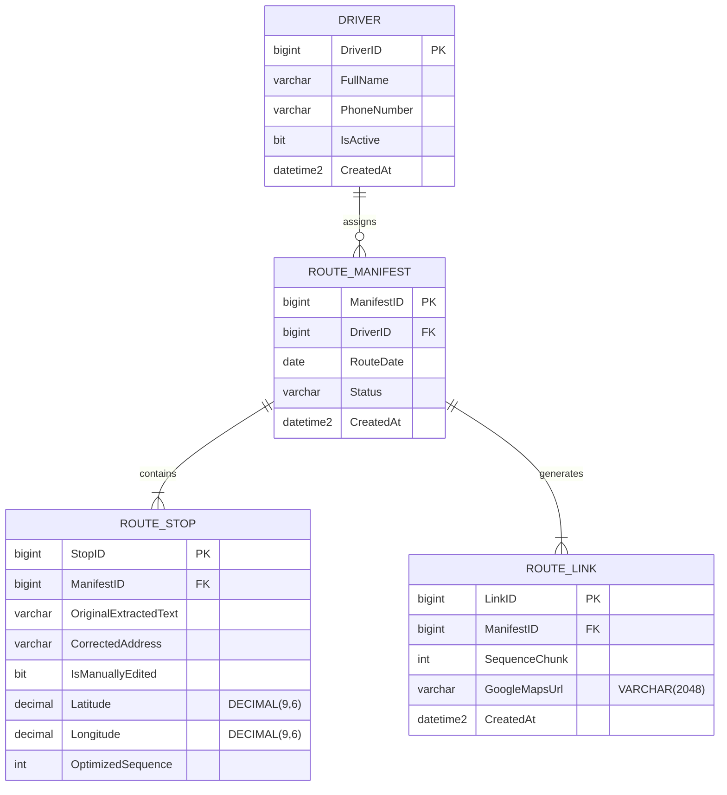

# Implementation Plan - RTPlan Multi-Stop Logistics & Routing API

## Overview
RTPlan is an "API-first" middleman backend designed to service both a **React web application (Phase 1)** and a **native Kotlin Android application (Phase 2)**. It orchestrates OCR/AI address extraction from physical manifest screenshots using Google Gemini 1.5 Flash, geocoding and TSP optimization using Google Maps APIs, and persistent storage in Microsoft SQL Server, along with Google Maps deep link chunking.

---

## Architecture & Technology Stack

| Component | Technology | Purpose |
|---|---|---|
| **Language & Runtime** | Java 25 LTS | Modern LTS Java runtime |
| **Framework** | Spring Boot 4.2.0 | Core DI, Web MVC, and Auto-configuration |
| **Persistence** | Spring Data JPA / Hibernate | ORM & Repository abstraction |
| **Database Driver** | `com.microsoft.sqlserver:mssql-jdbc` | Direct connectivity to SQL Server (`db1.ads.netyx.net`) |
| **HTTP Client** | Spring 7 `RestClient` | High-performance, modern fluent HTTP client for external APIs |
| **Boilerplate Reduction** | Project Lombok (1.18.48) | Auto-generation of getters, setters, builders, loggers |
| **Validation** | Jakarta Validation (`spring-boot-starter-validation`) | Request body & query parameter constraint checking |

---

## Domain Model & Database Schema



### Table Specifications
1. **`Driver`** (`drivers`):
   - `DriverID` (`BIGINT`, Identity PK)
   - `FullName` (`NVARCHAR(150)`, Not Null)
   - `PhoneNumber` (`NVARCHAR(30)`)
   - `IsActive` (`BIT`, Default 1)
   - `CreatedAt` (`DATETIME2`, Default `CURRENT_TIMESTAMP`)

2. **`RouteManifest`** (`route_manifests`):
   - `ManifestID` (`BIGINT`, Identity PK)
   - `DriverID` (`BIGINT`, FK to `drivers.DriverID`)
   - `RouteDate` (`DATE`, Not Null)
   - `Status` (`VARCHAR(30)`: `PENDING`, `VERIFIED`, `OPTIMIZED`)
   - `CreatedAt` (`DATETIME2`, Default `CURRENT_TIMESTAMP`)

3. **`RouteStop`** (`route_stops`):
   - `StopID` (`BIGINT`, Identity PK)
   - `ManifestID` (`BIGINT`, FK to `route_manifests.ManifestID`, Cascade delete)
   - `OriginalExtractedText` (`NVARCHAR(500)`)
   - `CorrectedAddress` (`NVARCHAR(500)`, Not Null)
   - `IsManuallyEdited` (`BIT`, Default 0)
   - `Latitude` (`DECIMAL(9,6)`)
   - `Longitude` (`DECIMAL(9,6)`)
   - `OptimizedSequence` (`INT`, 0-indexed sequence of execution)

4. **`RouteLink`** (`route_links`):
   - `LinkID` (`BIGINT`, Identity PK)
   - `ManifestID` (`BIGINT`, FK to `route_manifests.ManifestID`, Cascade delete)
   - `SequenceChunk` (`INT`, 1, 2, 3...)
   - `GoogleMapsUrl` (`NVARCHAR(2048)`, Not Null)
   - `CreatedAt` (`DATETIME2`, Default `CURRENT_TIMESTAMP`)

---

## Core External Integrations

### 1. Google Gemini 1.5 Flash API
- **Endpoint**: `https://generativelanguage.googleapis.com/v1beta/models/gemini-1.5-flash:generateContent?key={API_KEY}`
- **Payload**:
  - `systemInstruction`: Strict extraction rules requiring output as a JSON array of complete address strings.
  - `contents`: Multipart image blobs sent as Base64 `inlineData` with matching MIME types (`image/png`, `image/jpeg`, etc.).
  - `generationConfig`:
    - `responseMimeType`: `"application/json"`
- **Output Handling**: Parses returned JSON string into Java `List<String>`.

### 2. Google Maps Geocoding API
- **Endpoint**: `https://maps.googleapis.com/maps/api/geocode/json?address={address}&key={API_KEY}`
- **Function**: Takes address strings, queries the Geocoding API, and retrieves coordinates (`lat`, `lng`). Includes fallback/error handling for unresolvable addresses.

### 3. Google Maps Route Optimization / Routes API
- **Endpoint**: `https://routes.googleapis.com/directions/v2:computeRoutes`
- **Configuration**:
  - `optimizeWaypointOrder: true`
  - Origin: First address in the list (or designated depot/start location).
  - Destination: Last address (or loop back to depot).
  - Intermediates: Remaining stops.
- **Output**: Returns the `optimizedIntermediateWaypointIndex` permutation array, which is mapped to ordered `RouteStop` entries with `optimizedSequence`.

### 4. Route Chunking Logic (Google Maps Deep Links)
- **Constraint**: Google Maps directions navigation URLs support up to 10 points (1 origin + 9 intermediate/destinations).
- **Algorithm**:
  - For $N$ stops, divide stops into chunks of maximum 10 points.
  - Chunk 1: Origin = Stop 0, Destinations/Waypoints = Stops 1 through 9.
  - Chunk 2: Origin = Stop 9 (carried over from Chunk 1), Destinations = Stops 10 through 18.
  - Repeat until all stops are covered.
- **Format**:
  `https://www.google.com/maps/dir/?api=1&origin={origin}&destination={destination}&waypoints={waypoint1}|{waypoint2}|...`

---

## REST API Specification

### 1. `POST /api/routes/extract`
- **Request**: `multipart/form-data` with `files: MultipartFile[]`.
- **Response**:
  ```json
  [
    "123 Main St, Springfield, IL 62701",
    "456 Elm St, Springfield, IL 62702",
    "789 Oak Ave, Springfield, IL 62703"
  ]
  ```

### 2. `POST /api/routes/optimize`
- **Request Body**:
  ```json
  {
    "driverId": 1,
    "routeDate": "2026-11-20",
    "stops": [
      {
        "originalExtractedText": "123 Main St",
        "correctedAddress": "123 Main St, Springfield, IL 62701",
        "isManuallyEdited": true
      },
      {
        "originalExtractedText": "456 Elm St",
        "correctedAddress": "456 Elm St, Springfield, IL 62702",
        "isManuallyEdited": false
      }
    ]
  }
  ```
- **Response Body**:
  ```json
  {
    "manifestId": 101,
    "driverId": 1,
    "driverName": "Jane Doe",
    "routeDate": "2026-11-20",
    "status": "OPTIMIZED",
    "createdAt": "2026-11-20T16:00:00",
    "stops": [
      {
        "stopId": 1001,
        "optimizedSequence": 0,
        "address": "123 Main St, Springfield, IL 62701",
        "originalExtractedText": "123 Main St",
        "isManuallyEdited": true,
        "latitude": 39.781721,
        "longitude": -89.650148
      }
    ],
    "links": [
      {
        "linkId": 501,
        "sequenceChunk": 1,
        "googleMapsUrl": "https://www.google.com/maps/dir/?api=1&origin=39.781721,-89.650148&destination=..."
      }
    ]
  }
  ```

### 3. `GET /api/routes/manifests/{id}`
- **Response**: Complete manifest payload identical in format to the output of `/optimize`.

---

## Directory Structure
```
RTPlan/
├── pom.xml
├── mvnw
├── mvnw.cmd
├── .mvn/wrapper/maven-wrapper.properties
└── src/
    ├── main/
    │   ├── java/com/rtplan/
    │   │   ├── RtPlanApplication.java
    │   │   ├── config/
    │   │   │   ├── RestClientConfig.java
    │   │   │   ├── WebCorsConfig.java
    │   │   │   └── GoogleApiProperties.java
    │   │   ├── controller/
    │   │   │   ├── RouteController.java
    │   │   │   └── DriverController.java
    │   │   ├── dto/
    │   │   │   ├── request/
    │   │   │   │   ├── OptimizeRouteRequest.java
    │   │   │   │   ├── StopInputDto.java
    │   │   │   │   └── DriverCreateRequest.java
    │   │   │   └── response/
    │   │   │       ├── ManifestResponse.java
    │   │   │       ├── RouteStopResponse.java
    │   │   │       ├── RouteLinkResponse.java
    │   │   │       ├── DriverResponse.java
    │   │   │       └── ErrorResponse.java
    │   │   ├── entity/
    │   │   │   ├── Driver.java
    │   │   │   ├── RouteManifest.java
    │   │   │   ├── RouteStop.java
    │   │   │   ├── RouteLink.java
    │   │   │   └── ManifestStatus.java
    │   │   ├── exception/
    │   │   │   ├── ResourceNotFoundException.java
    │   │   │   ├── ExternalApiException.java
    │   │   │   └── GlobalExceptionHandler.java
    │   │   ├── repository/
    │   │   │   ├── DriverRepository.java
    │   │   │   ├── RouteManifestRepository.java
    │   │   │   ├── RouteStopRepository.java
    │   │   │   └── RouteLinkRepository.java
    │   │   └── service/
    │   │       ├── GeminiExtractionService.java
    │   │       ├── GoogleMapsGeocodingService.java
    │   │       ├── RouteOptimizationService.java
    │   │       ├── RouteChunkingService.java
    │   │       └── RouteManifestService.java
    │   └── resources/
    │       ├── application.yml
    │       └── schema-sqlserver.sql
    └── test/
        └── java/com/rtplan/
            └── RouteChunkingServiceTest.java
```
